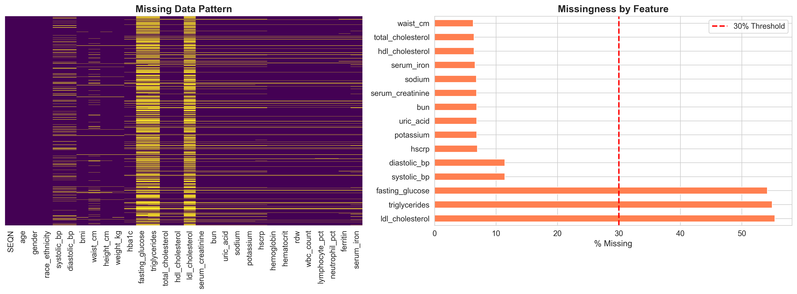
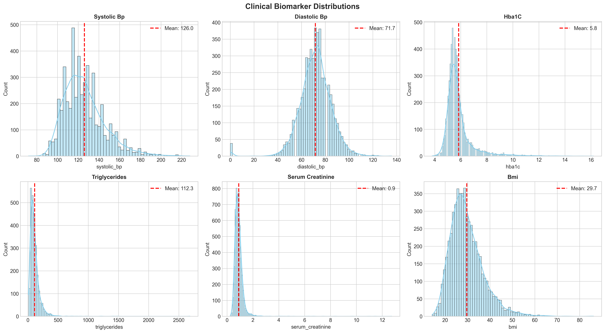
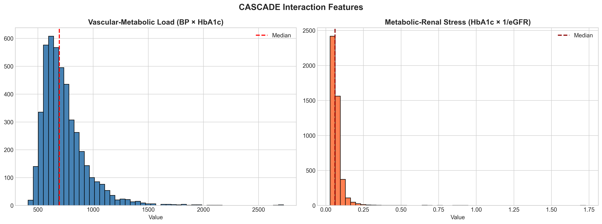
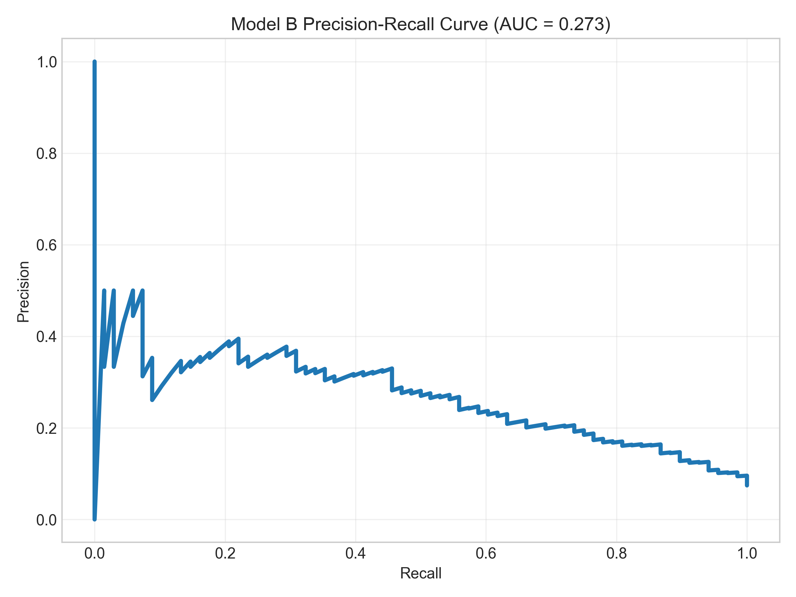
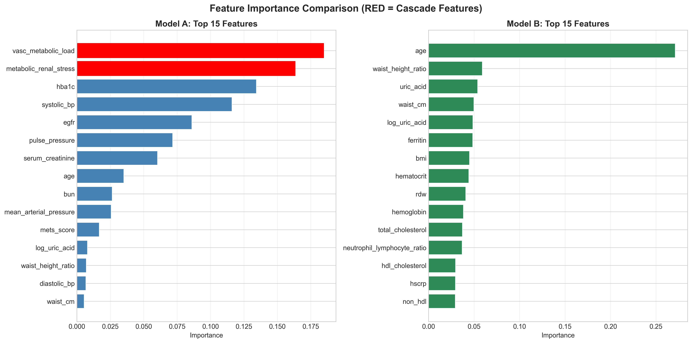
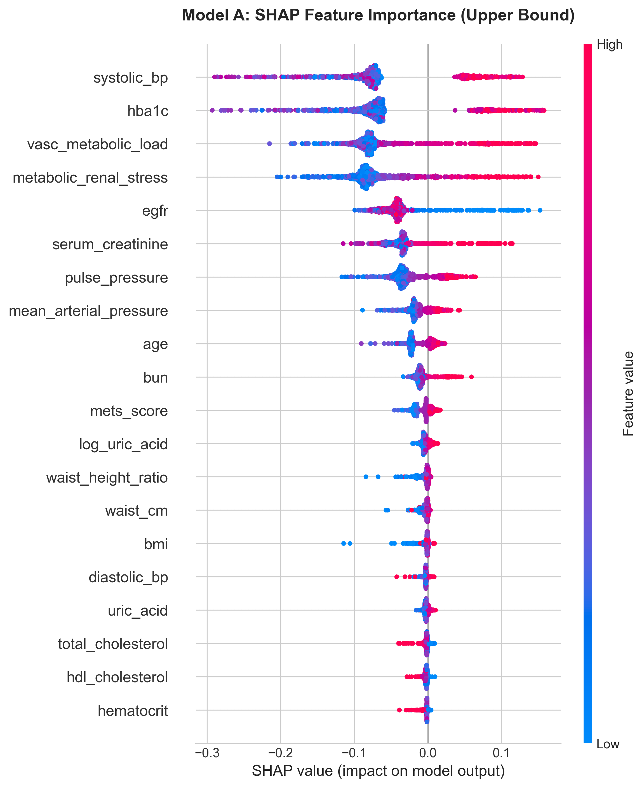
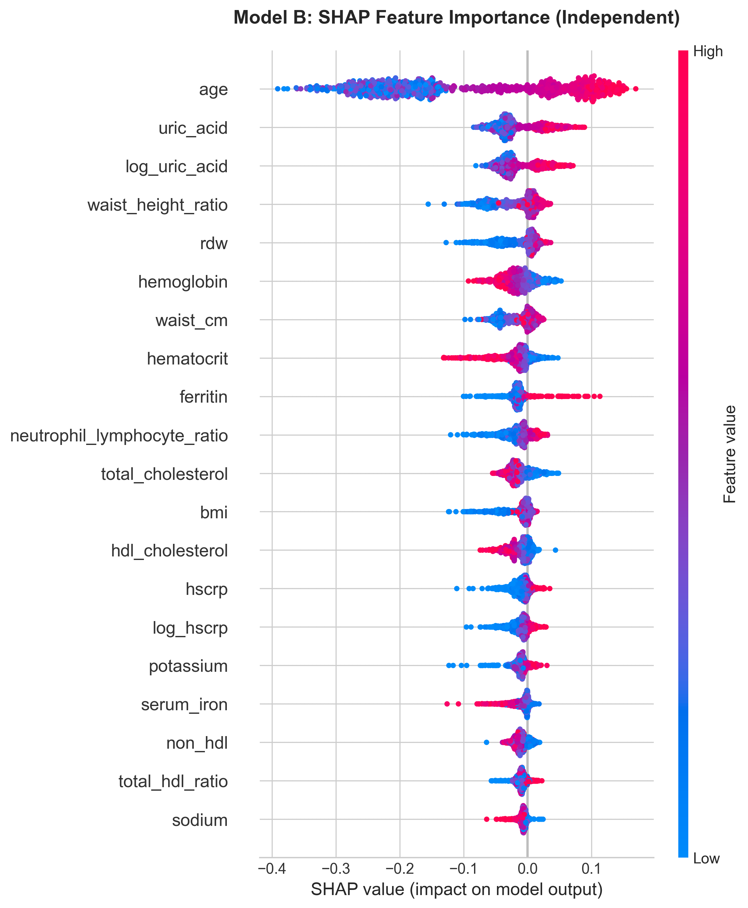
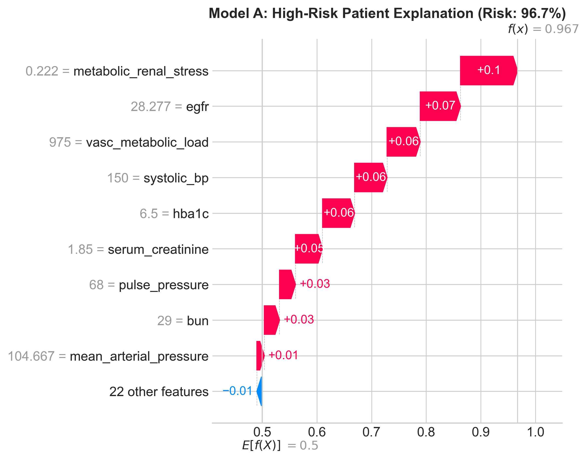
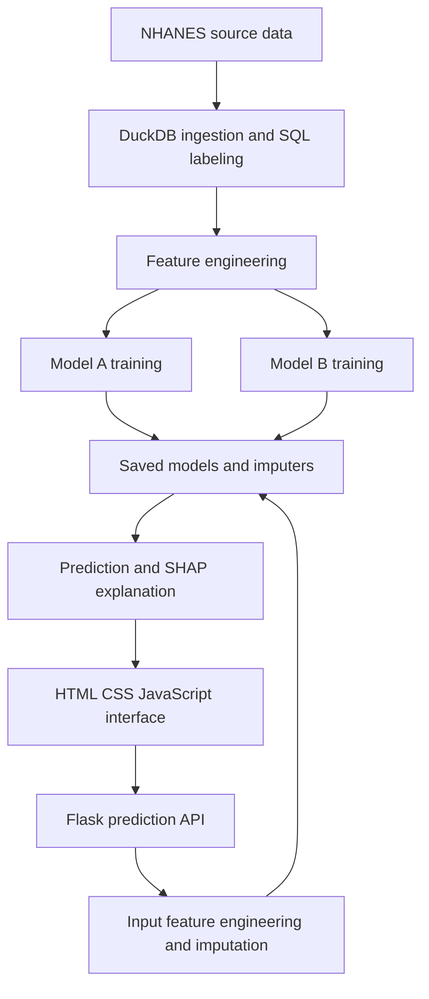

# 🧬 BioCascade

**Interpretable machine learning for multi-system cardiometabolic dysfunction**

BioCascade is a research-oriented, full-stack machine learning application inspired by heart failure with preserved ejection fraction (HFpEF). It combines biological domain knowledge, data engineering, statistical analysis, and explainable AI to investigate whether routine biomarkers can distinguish a research-defined vascular, metabolic and renal dysfunction phenotype.

> **Research only:** BioCascade does not diagnose HFpEF, predict future heart failure, or provide medical advice. Its target is a constructed proxy, not a clinically confirmed disease outcome.

**Explore:** [Research notebook](notebooks/BioCascade_Complete_Analysis.ipynb) · [Application source](app/) · [Data and ML pipeline](src/)

Live demo: deployment pending portfolio release.

## 1. Scientific motivation

Cardiometabolic dysfunction involves interconnected biological systems. BioCascade explores a *cascade hypothesis*: joint patterns of vascular stress, glucose dysregulation and impaired renal function may carry useful predictive information. The project uses engineered interaction features to investigate this idea, while distinguishing prediction of a constructed label from evidence of biological causation.

Two models address different questions:

- **Model A — Upper Bound:** How well can a model reconstruct the phenotype when given its defining biomarkers and derived features?
- **Model B — Independent:** How much predictive signal remains when direct label ingredients and their derivatives are excluded?

## 2. Dataset and data engineering

The analysis uses the NHANES 2017–2018 survey (CDC/NCHS), combining demographic, laboratory and examination data. DuckDB and SQL support ingestion, querying and phenotype construction; pandas and NumPy support transformation and feature engineering.

| Cohort characteristic | Recorded value |
|---|---:|
| Original adult participants | 5,533 |
| Raw dataset columns | 30 |
| Age range | 18–80 years |
| Mean age ± SD | 49.8 ± 18.6 years |
| Male participants | 2,672 (48.3%) |
| Female participants | 2,861 (51.7%) |
| Participants with phenotype labels | 4,573 |

The notebook reads `raw_patient_data` and `labeled_patients` from `data/processed/biocascade.db`.

### Data quality and missingness



**Figure 1.** Missingness was present in 26 raw columns. Fasting glucose, triglycerides and LDL cholesterol each had more than 50% missingness. This motivates feature availability filtering and imputation; it also limits what can be inferred from the observed sample.



**Figure 2.** Distributions of blood pressure, HbA1c, triglycerides, creatinine and BMI reveal differences in spread and skewness. These visual checks help identify variables needing transformation or further quality assessment; they do not establish that every observation is clinically valid.

## 3. Research phenotype definition

The notebook describes a binary target based on at least two of the following three indicators:

| System | Research indicator |
|---|---|
| Vascular | Systolic blood pressure ≥ 140 mmHg |
| Metabolic | HbA1c ≥ 6.5% |
| Renal | Serum creatinine > 1.3 mg/dL (male) or > 1.1 mg/dL (female) |

The precise threshold implementation should be checked against `sql/label_definition.sql` before regenerating labels (the earlier README used `> 140` for systolic BP).

| Proxy class | Count | Share | Mean age |
|---|---:|---:|---:|
| Low | 4,235 | 92.6% | 48.3 years |
| High | 338 | 7.4% | 67.8 years |
| Total | 4,573 | 100% | — |

The 7.4% figure is the frequency of the constructed label in the analyzed cohort, not HFpEF prevalence. The marked imbalance makes minority-class metrics particularly important.

## 4. Feature engineering and cascade interactions

The notebook reports approximately 16 engineered features and 51 total columns after transformation (not 51 model inputs).

| Feature family | Examples |
|---|---|
| Metabolic | TG/HDL ratio, non-HDL cholesterol, waist-to-height ratio, cardiometabolic index, metabolic syndrome score |
| Renal | Estimated glomerular filtration rate (eGFR), BUN/creatinine ratio |
| Vascular | Pulse pressure, mean arterial pressure |
| Inflammatory | Neutrophil-to-lymphocyte ratio, log-transformed hsCRP |
| Additional transformations | `log1p` of triglycerides and uric acid |

The two central interaction features are:

- **Vascular-metabolic load:** `systolic_bp × hba1c`
- **Metabolic-renal stress:** `hba1c / (egfr + 1)` (the implemented denominator includes a stabilizing offset).



**Figure 3.** Both engineered interaction features show right-skewed distributions. They encode joint biomarker patterns; their importance in a classifier does not by itself demonstrate physiological synergy or an improvement over individual components.

## 5. Dual-model methodology

| Property | Model A — Upper Bound | Model B — Independent |
|---|---|---|
| Model inputs | 31 | 21 |
| Algorithm | Random Forest | Random Forest |
| Direct label ingredients | Included | Excluded by design |
| Purpose | Label reconstruction benchmark | Evaluate indirect predictive signal |
| Main limitation | Circularity from label-related inputs | Modest minority-class detection and no external validation |

The recorded experiment used a stratified 80/20 split (3,658 training and 915 testing observations), random seed 42, median imputation fitted on training data, and balanced class weights. Candidate features with at most 50% observed values were filtered out. Model B excludes direct BP, glucose and creatinine inputs and label-derived interactions by design; the saved feature set and preprocessing should be audited before release.

## 6. Model evaluation

### Historical notebook results

| Metric | Model A | Model B |
|---|---:|---:|
| ROC-AUC | 0.9985 | 0.8221 |
| Accuracy (rounded) | 0.99 | 0.90 |
| High-class precision | 0.92 | 0.34 |
| High-class recall | 0.90 | 0.31 |
| High-class F1 | 0.91 | 0.33 |
| Average precision | — | 0.2733 |
| Reported mean cross-validation ROC-AUC | — | 0.8572 |

The test set contained 847 low-class and 68 high-class observations. These are historical notebook outputs, not independently reproduced metrics for the current deployed artifacts. The notebook narrative and some existing UI labels report slightly different values; the table uses the recorded numerical outputs. Cross-validation preprocessing still needs to be audited.


**Figure 4.** Model A nearly separates the constructed classes, as expected given its access to label-defining variables. Model B shows useful discrimination without those direct inputs, but ROC-AUC is not accuracy or a measure of probability calibration.



**Figure 5.** Model B's average precision (0.2733, calculated using `average_precision_score`) provides additional context for the rare positive class. At the recorded classification operating point, recall was only 0.31 and precision 0.34. This is an important limitation despite the ROC-AUC of approximately 0.82.



**Figure 6.** In the recorded impurity-based importance results, vascular-metabolic load (0.1847) and metabolic-renal stress (0.1633) were the two leading Model A features. Age (0.2713) led Model B. These importance scores are not causal effect estimates.

## 7. Explainable AI with SHAP

SHAP (SHapley Additive exPlanations) attributes a model output to its input features relative to a baseline. BioCascade provides population-level summary plots and individual waterfall explanations.

### Model A — Global explanations



**Figure 7.** The recorded mean absolute SHAP values rank systolic BP (0.0898), HbA1c (0.0886), vascular-metabolic load (0.0806) and metabolic-renal stress (0.0778) as the top four features. This is a separate ranking from Random Forest impurity importance. The notebook's later rank-printing cell is inconsistent with these values and should be corrected before rerunning the analysis.

### Model B — Global explanations



**Figure 8.** Age dominates the recorded mean absolute SHAP ranking (0.1489), followed by uric acid, log uric acid and waist-to-height ratio. These are model associations, not evidence that changing a feature changes disease risk.

### Individual explanations

| Model A — historical example | Model B — historical example |
|---|---|
|  |  |

**Figure 9.** The notebook selected separate high-score observations with outputs of 96.7% and 79.5%, respectively. Waterfall plots show how features shift each output from its baseline. These are not necessarily the same individual or calibrated probabilities of disease.

## 8. Interactive web application

The Flask application serves a dashboard and interactive screening demonstration built using vanilla HTML, CSS and JavaScript. It accepts biomarker inputs, engineers features, selects the appropriate model feature set, applies the saved imputer, generates a model score and returns a SHAP waterfall and contributing features.

Both models and SHAP outputs were smoke-tested locally during the portfolio revamp. The saved Model B is a scikit-learn pipeline; the app uses its underlying `rf` estimator for TreeExplainer while retaining the pipeline for prediction.

Current local smoke-test outputs for the same existing example profile: Model A 1.1%, Model B 52.0%. These demonstrate functionality only, not clinical validity. Synthetic demo profiles, clearer model selection and responsive layout improvements are planned for release.

## 9. System architecture



## 10. Technology stack

| Layer | Technologies |
|---|---|
| Data engineering | Python, DuckDB, SQL, pandas, NumPy, PyArrow |
| Machine learning | scikit-learn, Random Forest, joblib |
| Explainability and visualization | SHAP, matplotlib, seaborn |
| Backend | Flask |
| Frontend | HTML, CSS, vanilla JavaScript |
| Research | Jupyter Notebook |
| Packaging and version control | Docker, Git, GitHub |

## 11. Repository structure

```text
BioCascade/
├── app/
│   ├── app.py
│   ├── templates/
│   └── static/
│       ├── css/
│       ├── js/
│       └── plots/
├── data/
│   ├── raw/
│   └── processed/
├── notebooks/
│   └── BioCascade_Complete_Analysis.ipynb
├── sql/
├── src/
├── Dockerfile
├── requirements.txt
└── README.md
```

## 12. Run locally

```bash
git clone https://github.com/beko-1enkosi/BioCascade.git
cd BioCascade
python3 -m venv .venv
source .venv/bin/activate
python -m pip install -r requirements.txt
python app/app.py
```

Open `http://127.0.0.1:5000`. On Windows, activate with `.venv\Scripts\activate` instead. Python 3.13 was used in the local smoke test. The existing saved artifacts were serialized using different scikit-learn versions (1.8.0 and 1.9.0), while the smoke test used 1.9.1. Cross-version loading is not guaranteed to be reliable; a validated, pinned environment is a release requirement. Only load trusted model artifacts.

The repository includes saved models; retraining is not necessary for the current local demonstration. The original research notebook is retained for transparency. Its relative paths and full execution have not yet been reverified after relocation. Do not rerun training blindly over existing artifacts.

## 13. Findings, limitations and future work

The recorded experiment demonstrates that engineered interaction features are prominent in Model A and that indirect biomarkers provide discriminatory signal in Model B. It does not establish incremental benefit of interaction terms, causality, clinical utility or prospective disease prediction.

Key limitations include:

- **Target circularity:** Model A uses label ingredients and derivatives; it is a benchmark, not independent validation.
- **Proxy outcome:** NHANES does not supply confirmed HFpEF diagnoses for this analysis.
- **Cross-sectional design:** Temporal progression and future outcomes cannot be established.
- **Single survey cohort:** External validation and consideration of survey design and sampling weights are needed.
- **Missingness and class imbalance:** Feature availability and minority-class precision/recall constrain interpretation.
- **Calibration and thresholds:** Class weighting and a default classification threshold do not establish calibrated clinical probabilities.
- **Reproducibility:** Saved artifact versions, training-serving feature parity, historical plot provenance and cross-validation preprocessing require verification.

Future work includes a controlled feature-ablation study, leakage-safe evaluation, calibration and threshold analysis, consistent dependency and model versions, and external validation with appropriate confirmed outcomes. Longitudinal datasets, imaging and other modalities could be explored if available and scientifically justified.

## 14. Author and acknowledgments

**Thobeka Nkosi** — BSc Life Sciences (Biochemistry & Physiology) | Software Engineering

BioCascade began as a personal research and engineering project in March 2026, inspired by cardiovascular pathophysiology coursework.

Data: NHANES 2017–2018, CDC/NCHS. Research and application built with Python, DuckDB, scikit-learn, SHAP and Flask.

---

**Educational research prototype — not a medical device or clinical decision-support tool.**
